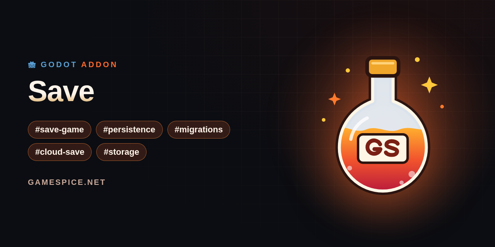

[](https://moddingcommunity.com/a/137-gs-save)

Godot 4.7+ addon for save games: slots, versioned documents with migrations, atomic writes, integrity checks and a pluggable local or cloud store that works on desktop, mobile and in the browser. Part of the [GameSpice](https://github.com/gamespice-platform) addon family. It needs only [GameSpice Core](https://github.com/gamespice-platform/core).

A save is a JSON payload wrapped in a small envelope (format, version, time, sha256). `GSSaveSlots` writes it to named slots through a `GSSaveStore`, keeps the previous copy as a backup, and on load verifies the checksum, falls back to the backup if the newest copy is damaged, and runs your migrations up to the current version.

## Install

1. Copy `addons/gs_save/` and `addons/gs_core/` into your project.
2. Enable gs-save in *Project > Project Settings > Plugins*.

## Quick start

```gdscript
var cfg := GSSaveConfig.from_files().value     # defaults, cfg/addon/gs_save/*.yml, GS_SAVE_*, --save-*
cfg.current_version = 2
var slots := GSSaveSlots.new(GSSaveStoreFile.new(cfg.directory, cfg.atomic_writes), cfg)
slots.migrations.add(1, func(d: Dictionary) -> Dictionary:
    d["gold"] = d.get("coins", 0)                # a step turns version N into N+1
    d.erase("coins")
    return d)

var r := slots.save("slot_1", {"gold": 120, "level": 4})
if not r.ok:
    push_warning(str(r.error))
var loaded := slots.load_slot("slot_1")          # value: {payload, version, saved_at, from_backup}
```

Write a different `GSSaveStore` (`read`, `write`, `remove`, `exists`, `keys`) to save somewhere else, for example to GameSpice Cloud. `GSSaveStoreMemory` is there for tests and servers that never persist.

## Settings

Every number is a field on `GSSaveConfig`. A zero in a limit means unlimited. Ranges are inspector slider limits, not enforced caps.

| Setting | Default | What it does |
| --- | --- | --- |
| `enabled` | true | Off, saves and loads fail with a state error. |
| `current_version` | 1 | The version this build writes; older saves migrate up to it. |
| `checksum` | true | Write and require a sha256 over the payload. |
| `max_bytes` | 0 | Largest accepted document; 0 is unlimited. |
| `max_slots` | 0 | Most slots a player may hold; 0 is unlimited. |
| `keep_backup` | true | Keep the previous copy and fall back to it. |
| `directory` | `user://saves` | Where the file store writes. |
| `atomic_writes` | true | Write a temporary file and rename it into place. |
| `set_aside_damaged` | true | When both copies are damaged, move the newest to `<slot>.sav.corrupt` (never deleted). |
| `autosave_seconds` | 0 | Interval for `GSSaveAutosave` while dirty; 0 saves only on flush, exit or pause. |
| `save_on_exit` | true | `GSSaveAutosave` flushes when the game closes or is paused. |
| `max_files` | 0 | Most files the file store holds; 0 is unlimited. |

## Slot tools and autosave

`slots.info(slot)` reads the version, time and size without migrating. `copy_slot(from, to, overwrite)` duplicates a slot, `restore_backup(slot)` is the player's undo for the last save. `GSSaveSlots` emits `saved`, `loaded` and `damaged`.

`GSSaveAutosave` is a node: call `setup(slots, "auto", provider)`, then `mark_dirty()` whenever something worth saving changed. It writes every `autosave_seconds` while dirty and on close or pause, and does not process at all while clean. `GSSaveStoreFile` rejects keys that are not plain file names, writes through the shared atomic writer (with the browser flush), and offers `set_aside(key)`.

## What it is not

- Not game settings: GameSpice Settings holds options with scopes and server policy. A save holds a player's progress.
- Not achievements, statistics or leaderboards: those are reported to the backbone by their own addons.
- Not a cloud client: GameSpice Cloud delivers content. A cloud save is a `GSSaveStore` you write over your own service.
- Not encryption. The checksum catches damage and casual edits, it does not stop a determined player. A server that cares keeps the state itself.

## Test

```bash
godot --headless --path . --import
godot --headless --path . res://examples/save_selftest.tscn
```

The self-test is offline and exits non-zero on any failure.

## Status

Built and maintained with Claude Code. The test suites pass, but little of this has been in front of real players yet. Please report rough edges by opening an issue.

## Licence

MIT. See [LICENSE](LICENSE). Only the TMC back-end web infrastructure is not open source.
